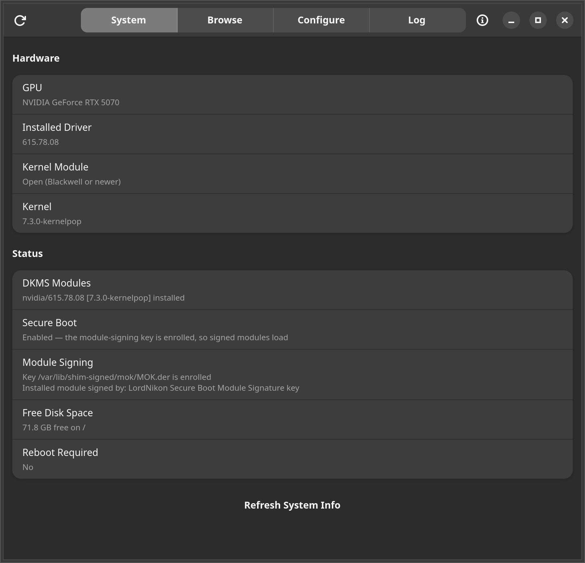
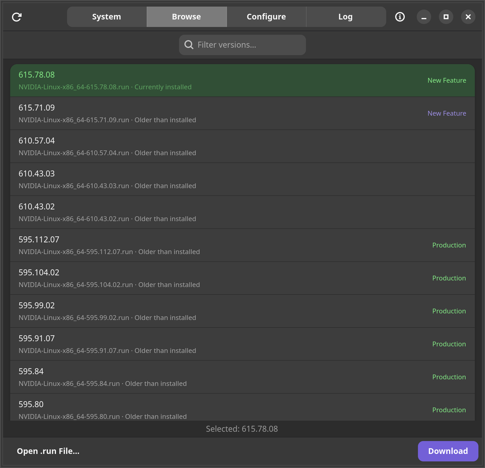
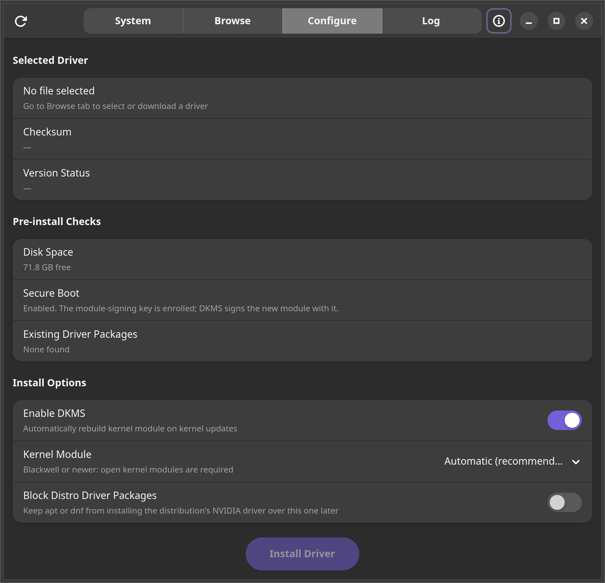
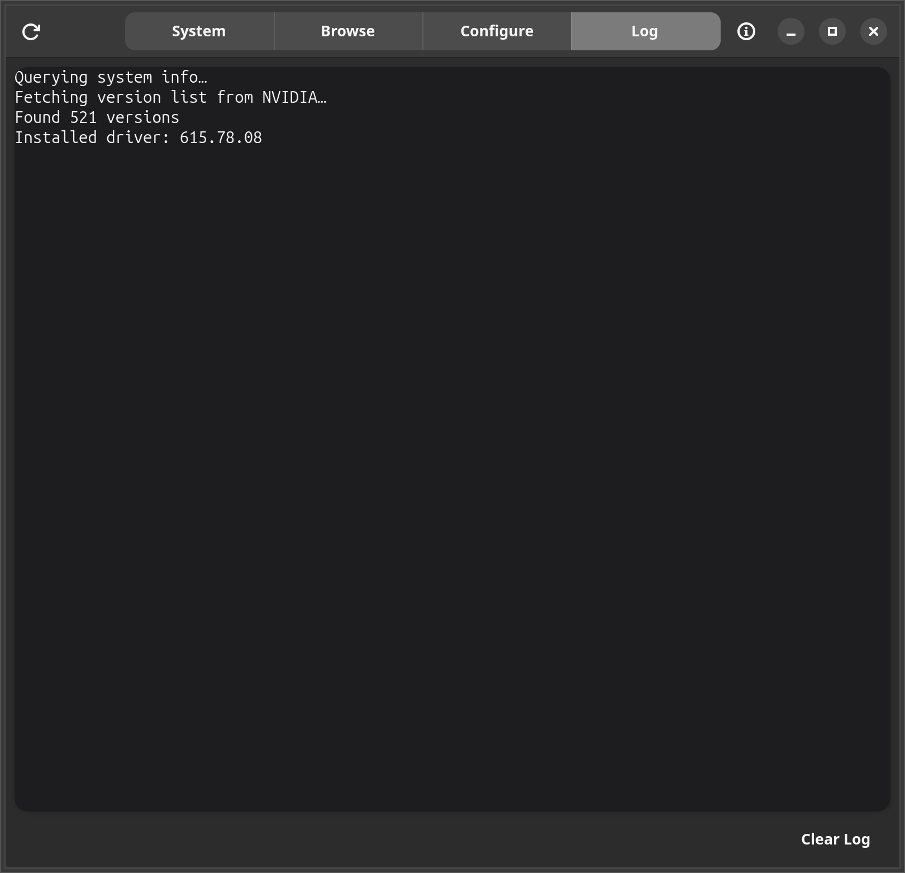
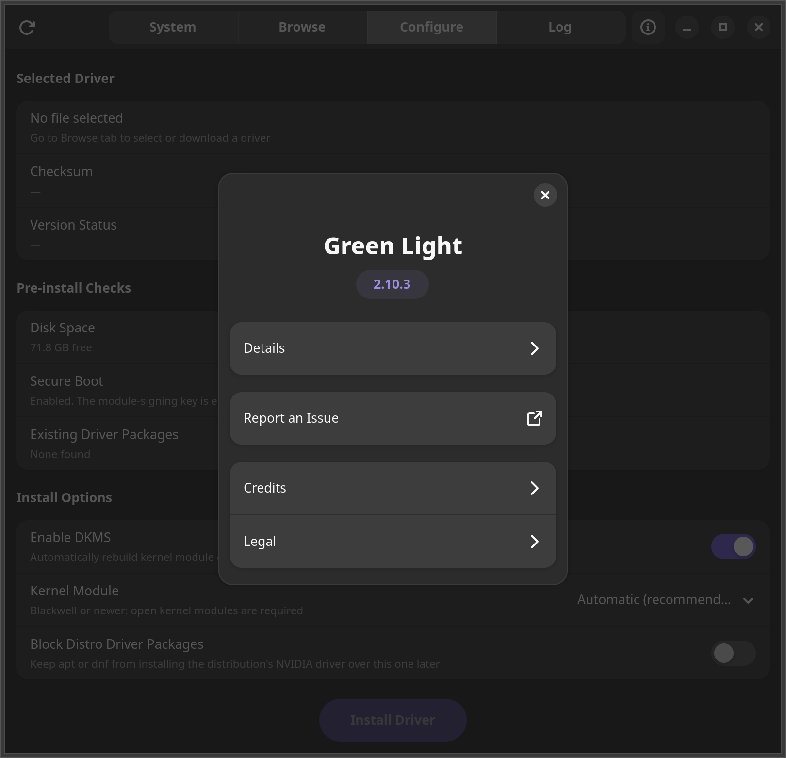

# Green Light

A Linux desktop app for installing NVIDIA drivers from the official `.run` files. Written in Rust with GTK4 and libadwaita.

I run NVIDIA's `.run` drivers instead of the packaged ones because the repos lag behind and I sometimes need a specific version. The usual routine for that is dropping to a TTY, stopping the display manager, running the installer blind, and hoping the desktop comes back. This app skips all of that. It installs the new driver to disk the same way a package manager does, while the current driver keeps running. The swap happens on your next reboot and your desktop never goes down.

## Screenshots

| System | Browse |
|---|---|
|  |  |

| Configure | Log |
|---|---|
|  |  |

| About |
|---|
|  |

## What it does

- Lists every driver version on `download.nvidia.com`, newest first, and marks the one you're currently running
- Labels each version's release branch (Production, New Feature, Long Term Support, or Legacy)
- Downloads and verifies against NVIDIA's published SHA256 sums
- Opens local `.run` files too, so Vulkan beta drivers or anything else you downloaded by hand work the same way
- Shows your GPU, running driver, kernel, DKMS status, Secure Boot state, and free disk space in one place
- Knows when a reboot is pending by comparing the kernel module on disk against the one that's loaded
- Registers the driver with DKMS so the module rebuilds itself on kernel updates
- Verifies the `.run` archive before changing anything, so a corrupt download stops the install with your current driver untouched
- Lets you choose open or proprietary kernel modules (Automatic by default) and refuses combinations that cannot work, such as open modules on a pre-Turing GPU
- Lists the distro driver packages the install will remove
- Signs the kernel module with your machine's module-signing key, once you've run Set Up Signing (see below)
- Checks the result after install (nouveau blacklist, initramfs, DKMS build, module signer) and shows the findings in the Log tab, with the DKMS build log tail if a build fails
- The GUI never runs as root. Only the install script does, through polkit, and you can read every line of it in `scripts/privileged-install.sh`

## Requirements

- x86_64 Linux with systemd and polkit
- Either an apt-based distro (Ubuntu, Debian, Mint) or a dnf-based distro (Fedora, RHEL, Nobara). The install script detects which one you have and uses the right package manager. Anything else, the GUI runs fine through the AppImage but the install script will refuse to run.
- Kernel headers and DKMS, which the script installs for you if missing (`linux-headers`/`build-essential` on apt, `kernel-devel`/`kernel-headers` on dnf)

Developed and tested on Ubuntu 26.04, GNOME on Wayland, RTX 5070, 595.x driver branch. Fedora support added in 2.4.0, less battle-tested than the Ubuntu path — if something's off on Fedora, open an issue.

## Install

Download the AppImage from [Releases](../../releases):

```bash
chmod +x green-light-*-x86_64.AppImage
./green-light-*-x86_64.AppImage
```

The first launch asks for your password once so it can place the install helper at `/usr/lib/green-light/` and register its polkit policy. After that it starts like any other app. If you later download a newer AppImage, it detects the change and refreshes those files on its own.

## Using it

1. The System tab shows your hardware and current driver state.
2. On the Browse tab, pick a version and hit Download, or use Open .run File if you already have one.
3. On the Configure tab, leave DKMS on, optionally turn on Block Distro Driver Packages, and hit Install Driver.
4. Enter your password and wait a few minutes while the kernel module builds. The desktop stays up the whole time.
5. Reboot whenever it suits you. The System tab shows Reboot Required: Yes until you do.

## Module signing and Secure Boot

With Secure Boot on, the kernel only loads modules signed by a key it trusts. Green Light signs the NVIDIA module with your machine's existing module-signing key, the same one DKMS uses: the key named by `mok_signing_key`/`mok_certificate` in `/etc/dkms/framework.conf` (or `framework.conf.d/`), otherwise Ubuntu's `/var/lib/shim-signed/mok/MOK.priv` and `MOK.der`, otherwise DKMS's `/var/lib/dkms/mok.key` and `mok.pub`. DKMS installs are signed by DKMS while it builds the module; without DKMS, the key is passed to NVIDIA's installer.

The Module Signing row on the System tab shows the key, whether it's enrolled, and who signed the installed module. Set Up Signing is a one-time step: it creates a key if your machine has none (`update-secureboot-policy --new-key` on Ubuntu, otherwise DKMS's own) and queues it for enrollment with a one-time password you choose. On the next reboot a blue MOK Manager screen appears; choose Enroll MOK and type that password. Setup doesn't touch the installed driver, so if the module on disk is unsigned, reinstall the driver once to sign it.

Without setup, and with no key on the machine, installs work exactly as before and nothing is signed.

## Headless servers

The GUI is optional. The install script is standalone bash and works the same on apt or dnf systems:

```bash
wget https://download.nvidia.com/XFree86/Linux-x86_64/595.84/NVIDIA-Linux-x86_64-595.84.run
wget https://download.nvidia.com/XFree86/Linux-x86_64/595.84/NVIDIA-Linux-x86_64-595.84.run.sha256sum
sha256sum -c NVIDIA-Linux-x86_64-595.84.run.sha256sum
sudo ./privileged-install.sh "$PWD/NVIDIA-Linux-x86_64-595.84.run" \
    "$(cut -d' ' -f1 NVIDIA-Linux-x86_64-595.84.run.sha256sum)" --dkms
```

The first two arguments are the absolute path of the `.run` file and its SHA256; the script verifies its own private copy against that hash before running anything. The file must not be writable by other users.

Flags:

| Flag | Effect |
|---|---|
| `--dkms` | Register the module with DKMS (recommended) |
| `--block-distro-driver` | Keep the package manager from installing the distribution's NVIDIA driver packages over this driver later: an apt pin on apt, an `excludepkgs` drop-in on dnf5 (not available with dnf4). An install without it removes the block |
| `--kernel-module-type=open\|proprietary` | Pick the kernel module flavor. Without it, NVIDIA's installer chooses from the detected GPUs (open for Turing and newer) |

Reboot afterward to switch drivers, same as the GUI flow.

Module-signing setup runs headless too; the script reads the one-time MOK password from stdin:

```bash
sudo ./privileged-install.sh --setup-signing
```

## Logs and troubleshooting

Two files tell you everything:

- `/var/log/green-light.log` is written by this app's install script, step by step
- `/var/log/nvidia-installer.log` is NVIDIA's own installer log

If an install fails, the reason is in one of those, and the Log tab shows the script's output as it runs. The most common cause is missing kernel headers for a brand new kernel, which resolves once your distro publishes them; the script checks for headers and a compiler before it removes anything, and stops without changes if they're missing. Before it removes anything it also test-builds the new driver's kernel module for your kernel. Before the first change it saves everything needed to undo it, including copies of the packages it is about to remove. If NVIDIA's installer then fails, or the install is stopped before the installer has run, the script removes what the installer had put in place, reinstalls the removed packages (and the packages that depend on them) from those copies, puts back holds, block and boot configuration, and checks that the previous driver is back (signed, under Secure Boot) before it says so; if it can't confirm that, it says not to reboot yet. If the computer loses power or the install is killed partway, the same happens at the next boot (`green-light-recover.service`), or from Restore Previous Driver in the app, or at the start of the next install. Closing Green Light, logging out or a shutdown request don't interrupt an install; shutdown and suspend are held off until it is done.

## Uninstalling

To remove the driver itself:

```bash
sudo nvidia-uninstall
```

To remove this app, delete the AppImage and optionally the helper files it installed:

```bash
sudo systemctl disable green-light-recover.service
sudo rm /etc/systemd/system/green-light-recover.service
sudo rm -rf /usr/lib/green-light /var/lib/green-light
sudo rm /usr/share/polkit-1/actions/io.github.labj1987.GreenLight.policy
sudo rm -f /etc/apt/preferences.d/green-light-nvidia /etc/dnf/libdnf5.conf.d/90-green-light-nvidia.conf
```

## Building from source

Needs `cargo`, `rustc`, `libgtk-4-dev`, `libadwaita-1-dev`, and `pkg-config`. The packaging step also needs `wget`, `file`, `desktop-file-utils` and `zsync`. The build script runs as an ordinary user; only on a machine with no toolchain does it install these through apt, and that one case needs root.

```bash
bash build-appimage.sh
```

The output lands in the project directory. `Cargo.lock` is committed, so builds are reproducible.

## How the install actually works

The script runs NVIDIA's installer with `--allow-installation-with-running-driver`, which is the same behavior your package manager relies on: files and the DKMS module go to disk, nothing touches the loaded driver, and the new one takes over at boot. Before that it verifies the archive with `--check`, makes sure headers, a compiler and DKMS are present (and stops if they aren't), clears any conflicting distro driver packages, blacklists nouveau, signs the module with your machine's signing key if it has one, and rebuilds the initramfs afterward. All plain bash, all readable.

## Acknowledgements

Development assistance: Claude Code (Anthropic) and Codex (OpenAI).

## License

AGPL-3.0-or-later. See [LICENSE](LICENSE).

Code at or before commit `fe3a6c563bfeff0391e0f9bab21f60533721cb7a` remains available
under the MIT License per its original release. From this commit forward,
AGPL-3.0-or-later.

Linnard Alex Brown Jr.
